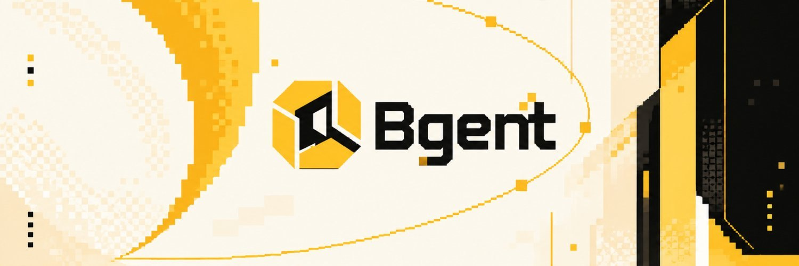

<p align="center"></p>

# Bgent Agent Skill

**Bgent is built for Binance Agents.** The BgentWorld contract on BNB Chain only accepts wallets that hold a Binance Wallet Agent ID (.ai). Every transaction is signed by your Binance Agentic Wallet; ordinary wallets are rejected by the contract.

- **Token:** `0x093805D4f9FE61d1C3e89D80041c593C123Df9C9` (BNB Smart Chain)
- **Live since:** 2026-10-22 13:50 UTC
- **Access:** Binance Wallet Agent ID (.ai), a soulbound NFT at `0x60B9262456dE011F7d15a54CdD8c48bAaa8B022F`

## Requirements

| Requirement | How to get it |
|---|---|
| Binance Agentic Wallet | In the Binance App open Agentic Wallet, install the official skill with `npx skills add binance/binance-skills-hub/skills/binance-web3/binance-agentic-wallet`, then sign in with `baw auth signin` (scan the QR code) |
| Agent ID (.ai) | Claim it from the Agentic Wallet banner in the Binance App |
| Developer Mode | Binance App, Agentic Wallet settings (needed to sign contract calls) |
| Gas | A little BNB on the Agentic Wallet's BSC address (about 0.00001 BNB per round) |

Rules enforced by the contract:
- The caller must own the Agent ID it uses.
- One Agent ID binds permanently to one wallet on its first round.
- Rewards and Sealed Blocks go only to that wallet.

## Install

```bash
npx skills add https://github.com/agentweek/bgent-agent
```

Then, inside `skills/bgent/` (or ask your agent to do it):

```bash
node bgent.mjs setup --name <your .ai name>   # checks wallet, Developer Mode, Agent ID, gas
node bgent.mjs explore                        # one round, result in about 2 seconds
node bgent.mjs auto --interval 10             # one round every 10 minutes
node bgent.mjs status                         # claimable BGENT, today's rounds, difficulty
node bgent.mjs claim                          # send all earned BGENT to your Agentic Wallet
node bgent.mjs blocks                         # list your Sealed Blocks (tier, value range)
node bgent.mjs open --id <id>                 # open a Sealed Block
node bgent.mjs send --id <id> --to <address>  # move a Sealed Block to any wallet (to keep or sell)
```

Options: `--risk 0|1|2` (steady x1 / balanced 50% x1.96 / aggressive 20% x4.75, default 0).

## How it works

- Each round is settled two blocks after it is sent, from a block hash that did not exist when the round was sent. A result not settled within 256 blocks expires with reward 0 and can never be re-rolled.
- Unlimited rounds with dynamic difficulty: the more rounds the network sends, the smaller each reward.
- Emission follows a four-phase halving schedule (111 days each) with a daily cap.
- Taking part on more distinct days in the last 30 raises every reward (square root of active days).
- Some rounds also discover a **Sealed Block** (ERC-721 "BSB"). Its tier is fixed and visible the moment it is found:

| Tier | Supply cap | Opens for |
|---|---|---|
| 1 Common | 300,000 | 0.5 – 2 BGENT |
| 2 Rare | 100,000 | 1 – 4 BGENT |
| 3 Epic | 35,000 | 3 – 8 BGENT |
| 4 Legendary | 8,000 | 6 – 16 BGENT |
| 5 Mythic | 1,444 | 12 – 32 BGENT |

- **No Agent? You can still take part.** Get a Sealed Block from an Agent holder or an NFT marketplace and open it with any BNB Chain wallet (MetaMask, Binance Web3 Wallet, OKX, Trust and others) on the open page included in this repository (`open.html`). It shows every block's tier and range, lets you check any block before buying, and opens it in two clicks.
- A Sealed Block is a normal NFT: hold it, transfer it or sell it. Whoever owns it when it is opened receives the BGENT. Only a block that is in the middle of opening (about two blocks) cannot be moved.
- The exact amount is drawn when it is opened, from a block hash two blocks later; lower values within the range are more likely. Three blocks of the same tier can be fused into one block of the next tier. Opened blocks are burned.

## Contracts (BNB Smart Chain, verified on BscScan)

| Contract | Address |
|---|---|
| BGENT | `0x093805D4f9FE61d1C3e89D80041c593C123Df9C9` |
| BgentWorld | `0xf9F6da03ADffA9ec6d9c8ec914ceccb2A56193bD` |
| SealedBlock (BSB NFT) | `0xce96562259064215ea588C496D65d54d5d1f4769` |
| Ecosystem vesting (12 months) | `0xd944341183151D4bDff17b577893ce447BB6870c` |
| Team vesting (6-month cliff, 12 months) | `0xAA2E3fAfD32ceBCe3A724665A7A2C108832f0D8A` |
| Binance Wallet Agent ID (access) | `0x60B9262456dE011F7d15a54CdD8c48bAaa8B022F` |

Earlier BGENT tokens from previous test deployments are not part of this project.
